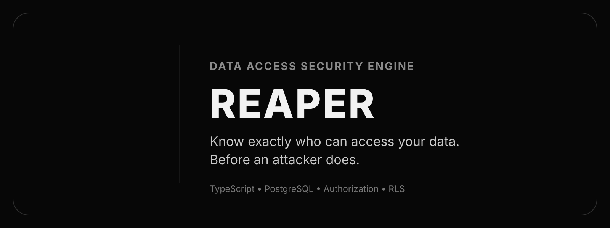
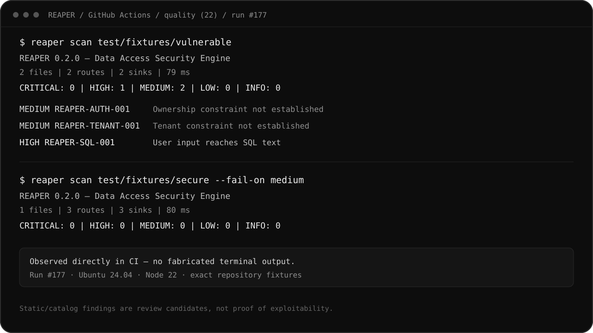

<p align="center">
  
</p>

<h1 align="center">REAPER</h1>

<p align="center"><strong>Data Access Security Engine</strong></p>
<p align="center"><em>Know exactly who can access your data. Before an attacker does.</em></p>

[](https://github.com/WessYu/REAPER/actions/workflows/ci.yml)
[](https://www.npmjs.com/package/@wess2001/reaper)

<p align="center">
  
</p>

REAPER traces request input into supported database calls and reports authorization, tenant-isolation, SQL, migration, secret and database-posture risks. It can combine source analysis with read-only PostgreSQL evidence and can run explicitly configured, bounded authorization assertions against authorized targets.

The current `main` branch is **0.2.0 development**. The latest published npm release is **0.1.1**. Static/catalog findings identify patterns worth investigating, not proof that an application is exploitable. Runtime findings are only marked CONFIRMED when an explicitly configured authorization assertion observes a status different from its declared security expectation. A clean report does not establish security. There is no AI dependency, telemetry or automatic database repair.

## Install and run

Requires Node.js 22 or 24.

Run directly from npm:

```sh
npx @wess2001/reaper@0.1.1 --help
npx @wess2001/reaper@0.1.1 scan ./application
```

Or install the CLI globally:

```sh
npm install -g @wess2001/reaper@0.1.1
reaper --help
reaper scan ./application
```

For local development:

```sh
git clone https://github.com/WessYu/REAPER.git
cd REAPER
npm ci --ignore-scripts
npm run build
node dist/cli.js scan test/fixtures/vulnerable
node dist/cli.js scan test/fixtures/secure --fail-on medium
```

The vulnerable fixture produces one SQL, one ownership and one tenant finding. The secure fixture produces none of those findings. Both are analysis fixtures, not deployable applications.

## Brand assets

The project artwork stays monochrome and keeps the original REAPER icon without redrawing it.

- [Original icon](assets/reaper-icon.webp)
- [SVG wrapper](assets/reaper-icon.svg)
- [Transparent-canvas SVG](assets/reaper-icon-transparent.svg)
- [README / portfolio banner](assets/reaper-banner.svg)

## Real CI proof

<p align="center">
  <a href="https://github.com/WessYu/REAPER/actions/runs/38094079292">
    
  </a>
</p>

This proof is rendered from the actual output of GitHub Actions run **#177** on Node.js 22. The vulnerable fixture produced one HIGH and two MEDIUM findings; the secure fixture completed with zero findings at the MEDIUM gate. The workflow executes those CLI commands directly after installing the packed REAPER tarball.

[View the exact CI run →](https://github.com/WessYu/REAPER/actions/runs/38094079292)

## Implemented coverage

| Area            | Current behavior                                                                                                                                                                                                        |
| --------------- | ----------------------------------------------------------------------------------------------------------------------------------------------------------------------------------------------------------------------- |
| Parsing         | TypeScript compiler AST and symbol resolution for JS, TS, JSX and TSX                                                                                                                                                   |
| Routes          | Express/Fastify registrations, supported sequential middleware and Next.js `route.ts` exported handlers                                                                                                                 |
| Flow            | Assignments, destructuring, shared-object/property mutation, local imports, direct calls, `.bind`/`.call`/`.apply`, common Object/Reflect alias patterns, arrays, branches, bounded loops, try/catch/finally and switch |
| SQL             | Tainted SQL text in pg, Prisma unsafe raw calls and Knex raw; parsed constant UPDATE/DELETE without WHERE                                                                                                               |
| Data access     | Prisma authorization reasoning plus Supabase, Knex and Drizzle data-access discovery                                                                                                                                    |
| PostgreSQL      | Read-only catalogs for tables, RLS, policies, inherited roles, table/schema/column grants, functions, views/materialized views and triggers                                                                             |
| RLS             | Identity/tenant/role/constant classification plus bounded AND/OR and permissive/restrictive policy-composition reasoning; arbitrary SQL remains conservative                                                            |
| Supabase        | Service-role exposure, table/RPC/Storage graph discovery, table/RPC/Storage source-to-catalog correlation                                                                                                               |
| Migrations      | SQL migration review for RLS removal, policy drops and broad grants                                                                                                                                                     |
| Secrets/Crypto  | Embedded database credentials/private keys and fast password-hash misuse                                                                                                                                                |
| Verification    | Authorized assertions, bounded OpenAPI GET/HEAD discovery/probing, optional synthetic-user provisioning and setup/teardown, budgets, rate limits, timeouts and cancellation                                             |
| Attack          | Explicitly authorized stateful adversarial scenarios with identity switching, captured variables, known-resource authorization checks, cleanup, audit trail, circuit breaker and DNS-change stop                        |
| Platform        | Self-contained HTML dashboard, localhost-only REST service and programmatic Rule SDK                                                                                                                                    |
| Output          | Terminal, JSON, Markdown, SARIF 2.1.0, explanations, DOT/JSON graph and explainable security score                                                                                                                      |
| Review workflow | Stable fingerprints, baselines, justified line suppressions and report diffs                                                                                                                                            |

Local import resolution follows standard TypeScript module resolution within discovered files. The scanner does not load the target's compiler plugins, execute its configuration or import its dependencies.

## Authorization assumptions

A field named `userId` is not enough to infer an ownership relationship. REAPER uses a recognized Prisma `@relation(fields: [...])` to a conventional `User`/`Owner` or tenant model, or explicit configuration.

The default trusted principal paths are `req.user.id`, `request.user.id`, `req.auth.userId`, `request.auth.userId`, and the `tenantId`/`organizationId` properties of `req.user` and `request.user`. This is a **modeling assumption**: REAPER does not prove that authentication middleware established those values. Verify that assumption before relying on a scoped-query result.

Ownership and tenant findings are conservative. REAPER can model supported direct post-query deny guards, sequentially resolved Express/Fastify middleware that mutates the shared request object, and explicitly configured contracts for opaque authorization middleware. Dynamically selected wrappers and external authorization services that are neither resolvable nor configured still require review.

```ts
// reaper.config.ts — literal data only
export default {
  resources: {
    invoice: {
      ownership: ["userId"],
      tenant: ["organizationId"],
    },
  },
  principalPaths: ["req.user.id", "req.user.organizationId"],
  middleware: {
    requireAuth: {
      establishes: ["req.user.id"],
    },
  },
  exclude: ["fixtures"],
  maxFiles: 10000,
  maxFileBytes: 1000000,
  verify: {
    allowedTargets: ["https://preview.example.com"],
    maxRequests: 20,
    concurrency: 2,
    timeoutMs: 5000,
    rateLimitPerSecond: 5,
    discoverOpenApi: true,
    openApiPaths: ["/openapi.json"],
    probeDiscovered: true,
    allowMutations: true,
    syntheticUsers: {
      count: 2,
      path: "/test/signup",
      body: {
        email: "reaper-{{SYNTHETIC_RUN}}-{{SYNTHETIC_INDEX}}@example.test",
      },
      expectStatus: 201,
      tokenPath: "token",
      idPath: "user.id",
      cleanup: {
        path: "/test/users/{{USER_ID}}",
        expectStatus: 204,
      },
    },
    assertions: [
      {
        name: "cross-tenant order must be denied",
        path: "/api/orders/synthetic-tenant-b-order",
        expectStatus: 403,
        authEnv: "REAPER_TEST_USER_A_TOKEN",
        dimension: "tenant",
      },
    ],
  },
};
```

The CLI automatically reads this file at the scan root. `--config` selects another file. Calls, imports-as-values and executable expressions are rejected. `exclude` matches directory/file basenames, not glob patterns. The programmatic API accepts `config` or `configFile` explicitly.

## Commands

```sh
reaper scan ./application --format json --output scan.json
reaper sql ./application
reaper authz ./application
reaper tenants ./application
reaper supabase ./application
reaper migrations ./application
reaper crypto ./application
reaper scan ./application --db-env DATABASE_URL --format json --output combined.json
reaper graph combined.json --format dot --output graph.dot
reaper cfg ./application --format dot --output control-flow.dot
reaper score combined.json
reaper discover http://localhost:3000 --config reaper.config.ts
reaper verify http://localhost:3000 --config reaper.config.ts --fail-on high
reaper attack https://preview.example.com --config reaper.config.ts --fail-on high
reaper dashboard combined.json --output reaper-dashboard.html
reaper serve ./application --port 7337
reaper baseline scan.json --output baseline.json
reaper scan ./application --baseline baseline.json --fail-on high
reaper report scan.json --format sarif --output reaper.sarif
reaper report scan.json --format markdown --output review.md
reaper diff previous.json scan.json
reaper explain REAPER-SQL-001:0123456789ab --input scan.json
reaper doctor
```

Use an actual finding ID from your report with `explain`. `diff` compares saved findings, not SQL migrations or Git trees. Baselines only acknowledge exact fingerprints; findings remain in the report. Fingerprints are stable across blank-line changes but may change after query, route or path edits. Identical queries in the same file and route currently share an identity.

Exit codes: **0** completed without a failed gate; **1** new findings meet `--fail-on`; **2** invalid input, operational error or reported incomplete analysis. A completed scan still has the coverage limits below.

Suppression applies to the immediately following finding line and requires a specific rule and a reason of at least ten characters:

```ts
// reaper-ignore REAPER-AUTH-001 -- reason: ownership is enforced by the reviewed object guard
return prisma.order.findUnique({ where: { id: req.params.id } });
```

## PostgreSQL

Set `DATABASE_URL` through your shell or secret manager. It is never accepted as a CLI flag value or stored by REAPER.

```sh
reaper schema --db-env DATABASE_URL --output catalog.json
reaper rls --db-env DATABASE_URL --format json --output rls.json
reaper privileges --db-env DATABASE_URL
```

Inspection uses a repeatable-read, read-only transaction with connection, query, statement and lock timeouts. It reads system catalogs; it does not fetch application rows, execute migrations or invoke application functions. TLS follows the pg connection settings; certificate checks are not disabled.

Passing `--db-env` to a source command explicitly combines source findings with a database snapshot. Supported Supabase table, RPC and Storage paths can be correlated with PostgreSQL grants, RLS policies and SECURITY DEFINER posture. This raises confidence because both source and catalog evidence were observed, but it still does not prove internet exposure or exploitability.

A broad table grant plus missing RLS is a review candidate, not proof of public API exposure. RLS with no policies is default-deny information. REAPER classifies common `auth.uid()`, JWT tenant, role-only and constant policy predicates, while arbitrary SQL predicates remain conservative. Role membership with ROLINHERIT is expanded for effective grants. Broad schema CREATE, BYPASSRLS/SUPERUSER roles, client-readable owner-rights views, privilege-sensitive triggers and broadly executable SECURITY DEFINER functions with unsafe `search_path` are reviewed.

Only connect to databases you are authorized to inspect. Start with a dedicated low-privilege role. Catalog snapshots reveal schema and role names; handle reports as internal security material.

## Authorized runtime verification

`reaper verify` remains authorization-scoped rather than an open-ended web scanner. Localhost targets are permitted automatically. Remote origins are blocked unless their exact origin is listed in `verify.allowedTargets`.

REAPER can optionally discover GET/HEAD operations from an allowlisted target's OpenAPI document and, when `probeDiscovered: true`, issue bounded safe probes to non-templated discovered GET/HEAD routes. Assertions remain operator-defined. Synthetic scenario setup/teardown can use POST, PUT, PATCH or DELETE only when `verify.allowMutations: true` is explicitly configured. `syntheticUsers` can provision 2–4 test identities from an explicitly configured signup template, capture token/ID JSON paths in memory, expose `USER_1_TOKEN`/ `USER_1_ID`-style variables to assertions, and clean the identities up through an explicitly configured DELETE path. Token values are not copied into findings.

Redirect following is disabled. Concurrency, request rate, total request budget, response-capture size and per-request timeout are bounded, and Ctrl+C cancellation is propagated through the scenario. A runtime finding means a security property that **you explicitly declared** did not produce the expected HTTP status. REAPER does not brute-force credentials, crawl arbitrary internet targets or invent destructive requests.

Library callers can use `createAttackJob` and `runAttackJob` to execute the trusted engine in a separate Node child process. The runner validates a job envelope, limits input/report/stdout/stderr sizes, filters the worker environment to referenced secrets and platform variables, sets a V8 heap limit and uses a temporary working directory. Deadline or caller cancellation reaches the engine first so it can attempt declared cleanup; the runner force-kills the worker after the bounded cleanup grace period. This is not an OS sandbox: the worker retains the current user's filesystem permissions, heap limits do not cap total RSS, and deployment controls must enforce CPU, filesystem and network egress policy. The existing CLI and direct `runAttack` API remain in-process.

## Authorized adversarial validation

`reaper attack` is a stateful authorization-focused validation mode. It is intentionally configuration-driven rather than an unrestricted crawler or exploit framework.

Every attack run requires an exact target origin, an explicit authorization acknowledgement/reference, bounded active and cleanup request budgets, and configured scenarios or authorization matrices. Production runs cannot enable mutations and production authorization must have an expiry that remains valid throughout the run. Nonproduction scenarios that mutate state must declare cleanup steps. RFC1918/ULA-style private targets require a separate `allowPrivateNetwork` opt-in; link-local, unspecified, multicast and reserved infrastructure addresses remain blocked. Redirects are not followed, outbound connections are pinned to the initially approved DNS resolution and resolution changes stop the run, consecutive server errors open a circuit breaker, and authentication values loaded from environment/captured variables are not written into findings.

Strict deployments can set `attack.requireSignedScope: true` and pass an Ed25519 manifest plus trusted public key to the `runAttack` API. The manifest binds approved origins, assessment reference, environment, expiry, permissions, request caps and a global deadline. CLI users provide JSON through `REAPER_SCOPE_MANIFEST` and the trusted PEM key through `REAPER_SCOPE_PUBLIC_KEY`. Key distribution and replay prevention remain deployment responsibilities; see [the authorization scope contract](docs/offensive-safety-contract.md).

Release SBOM, SHA-256 hashes and tag provenance details are documented in [supply-chain evidence](docs/supply-chain.md).

Stateful flows can capture JSON values and session cookies, then reuse them through bearer, cookie or secret-backed header identities. Ownership/tenant matrices can systematically test each configured actor against foreign-owned test resources. For ownership, tenant and vertical-authorization confirmation, a denial expectation must identify both a configured actor and a known test resource. HTTP 5xx, redirects and ambiguous 4xx responses remain inconclusive by default: confirmation defaults to HTTP 2xx unless `confirmStatuses` narrows that set. Optional `jsonEquals` response proof can additionally require the returned JSON to match known resource identity/ownership fields before a `REAPER-ATTACK-001` finding becomes CONFIRMED.

A saved source/database report can be supplied with `--input`. REAPER then correlates the confirmed runtime route with matching source graph routes, reachable data resources and related static/catalog findings; this adds evidence but does not replace the runtime proof.

```ts
export default {
  attack: {
    allowedTargets: ["https://preview.example.com"],
    authorization: {
      acknowledged: true,
      reference: "SEC-1842 / approved preview assessment",
      environment: "preview",
      expiresAt: "2026-10-13T12:00:00.000Z",
    },
    maxRequests: 40,
    maxCleanupRequests: 10,
    timeoutMs: 5000,
    rateLimitPerSecond: 3,
    maxConsecutiveServerErrors: 3,
    identities: {
      userA: { tokenEnv: "REAPER_USER_A_TOKEN" },
    },
    scenarios: [
      {
        id: "cross-user-order",
        title: "User A must not read User B order",
        dimension: "ownership",
        steps: [
          {
            name: "cross-user read",
            path: "/api/orders/{{USER_B_ORDER_ID}}",
            actor: "userA",
            resource: "order:{{USER_B_ORDER_ID}}:owner:userB",
            expect: {
              deniedStatuses: [403, 404],
              confirmStatuses: [200],
              jsonEquals: {
                id: "{{USER_B_ORDER_ID}}",
                ownerId: "{{USER_B_ID}}",
              },
            },
          },
        ],
      },
    ],
  },
};
```

The example assumes `USER_B_ORDER_ID` and `USER_B_ID` were captured by earlier explicitly configured setup steps. For broader BOLA/tenant coverage, `attack.matrices` accepts configured actors plus owned test resources and executes only foreign actor/resource combinations. Matrix paths use `{{RESOURCE_ID}}`; optional proof expressions can also reference `{{RESOURCE_OWNER}}` and `{{ACTOR}}`.

Session-based applications can capture a named `Set-Cookie` value with `captureCookies` and attach it through an identity `cookie.valueVar`. API keys or other request credentials can be sourced from named environment variables through `headerEnvs`; protocol-sensitive headers such as Host, Authorization and Cookie cannot be injected through that generic header map.

To correlate runtime evidence back to an earlier source/database report:

```sh
reaper attack https://preview.example.com --config reaper.config.ts --input combined.json --format json
```

Cleanup uses a separate bounded reserve so normal request-budget exhaustion does not strand declared test data. On Ctrl+C or external cancellation, active work stops while declared cleanup receives a bounded best-effort attempt using its own per-request timeout.

REAPER does not invent users, credentials, ownership or destructive requests. See [offensive safety contract](docs/offensive-safety-contract.md).

## TypeScript API

```ts
import { scan, report } from "@wess2001/reaper";

const result = await scan({
  root: process.cwd(),
  rules: [
    {
      id: "REAPER-CUSTOM-001",
      run(context) {
        // Programmatic custom rules can inspect the normalized report/graph
        // and emit deterministic findings through context.add(...).
      },
    },
  ],
});

console.log(report(result, "json"));
```

## Architecture

`project.ts` bounds file discovery and extracts basic Prisma relationships. `analysis.ts` uses the compiler's symbols and a bounded abstract interpreter to propagate input provenance into database sinks. `cfg.ts` builds an explicit statement/branch/loop control-flow graph for review/export. `sql.ts` parses constant SQL. `postgres.ts` collects and reviews catalog evidence, including view dependencies and function definitions. `model.ts`, `findings.ts` and `reporter.ts` define the public result contract, fingerprints and output formats. `cli.ts` orchestrates those modules.

The graph represents observed route → query → resource edges. It is not yet a complete authorization or privilege graph. Source text and credentials are not copied into findings; flow evidence contains labels and locations.

## Validation and CI

```sh
npm run check
npm pack
# A disposable database is required for this separate integration suite:
node --test test/integration/postgres.mjs
```

For the integration command, set `REAPER_TEST_DATABASE_URL` to a disposable PostgreSQL database. **The test harness creates and drops synthetic tables and a test role**; production introspection does not. GitHub Actions runs Node 22/24, PostgreSQL 17 integration, lint, formatting, strict typechecking, unit/CLI tests and installation from the packed tarball.

SARIF can be uploaded with GitHub's Code Scanning action in a consuming repository. Review repository access and report sensitivity before uploading. REAPER itself does not upload reports.

## What REAPER does not pretend to solve

REAPER is not a complete JavaScript interpreter, a formal authorization prover or an unrestricted penetration-testing engine.

Real boundaries remain: proof-complete CFG/points-to analysis, arbitrary proxies and runtime metaprogramming, dynamically selected middleware without an explicit contract, unrestricted symbolic reasoning over RLS SQL/functions/subqueries, complete transitive semantics for views/triggers/functions, endpoint discovery beyond authorized OpenAPI GET/HEAD probing, and autonomous account creation without an operator-supplied test flow.

The dashboard, localhost REST service and Rule SDK are implemented support surfaces; they do not replace engine precision. The priority remains deterministic evidence, deeper framework/data-layer correlation and resistance to false positives and false negatives rather than inflating the feature list.

## Known limits and next work

- Control-flow and alias analysis are **bounded abstract interpretation**, not a proof-complete JavaScript execution model. Loops are analyzed conservatively without arbitrary fixed-point iteration, recursion is bounded, and async/event context is not fully reconstructed.
- Shared-object property mutation, direct function calls, `.bind`/`.call`/`.apply`, `Object.assign`, `Object.defineProperty`, `Reflect.get`/`Reflect.set`, supported middleware chains, try/catch/finally and switch are modeled. Proxies, runtime code generation, arbitrary decorators and highly dynamic dispatch remain conservative.
- Next.js support is centered on exported route handlers. Express/Fastify middleware can be resolved from source or represented by literal `middleware.*.establishes` contracts; dynamically selected middleware without a contract still requires review.
- RLS reasoning recognizes common identity, tenant, role-only and constant patterns, bounded AND/OR composition and PostgreSQL permissive/restrictive interaction. It does not theorem-prove arbitrary SQL functions, subqueries or procedural policy helpers.
- PostgreSQL view dependencies, trigger metadata and SECURITY DEFINER function definitions are inspected, including dynamic-SQL review. Full transitive privilege composition, trigger-body semantics and extension-specific authorization models remain conservative. Column grants are collected but are not yet fully correlated with selected fields.
- Prisma has the deepest authorization semantics. Drizzle and Knex are represented in the data-access graph, but their ownership/tenant reasoning is not yet as rich as Prisma's.
- OpenAPI discovery/probing is intentionally limited to GET/HEAD operations from configured documentation endpoints and skips templated paths during automatic probes. Synthetic identity creation is template-driven; REAPER does not guess signup flows, MFA/CAPTCHA handling, credentials or destructive cleanup semantics.
- The localhost REST service is intentionally small and unauthenticated because it binds only to `127.0.0.1`; it is not a hosted multi-user service.
- The numerical score is a triage aid. A clean scan or a high score is not authorization assurance.

The next work should focus on precision, framework-specific authorization adapters and deeper data-layer correlation rather than adding unsupported breadth. See [rules](docs/rules.md), [security policy](SECURITY.md) and [contributing](CONTRIBUTING.md).
